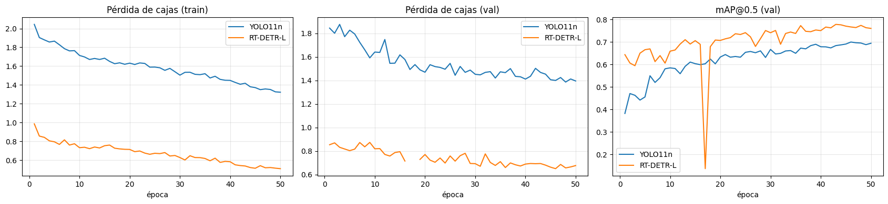
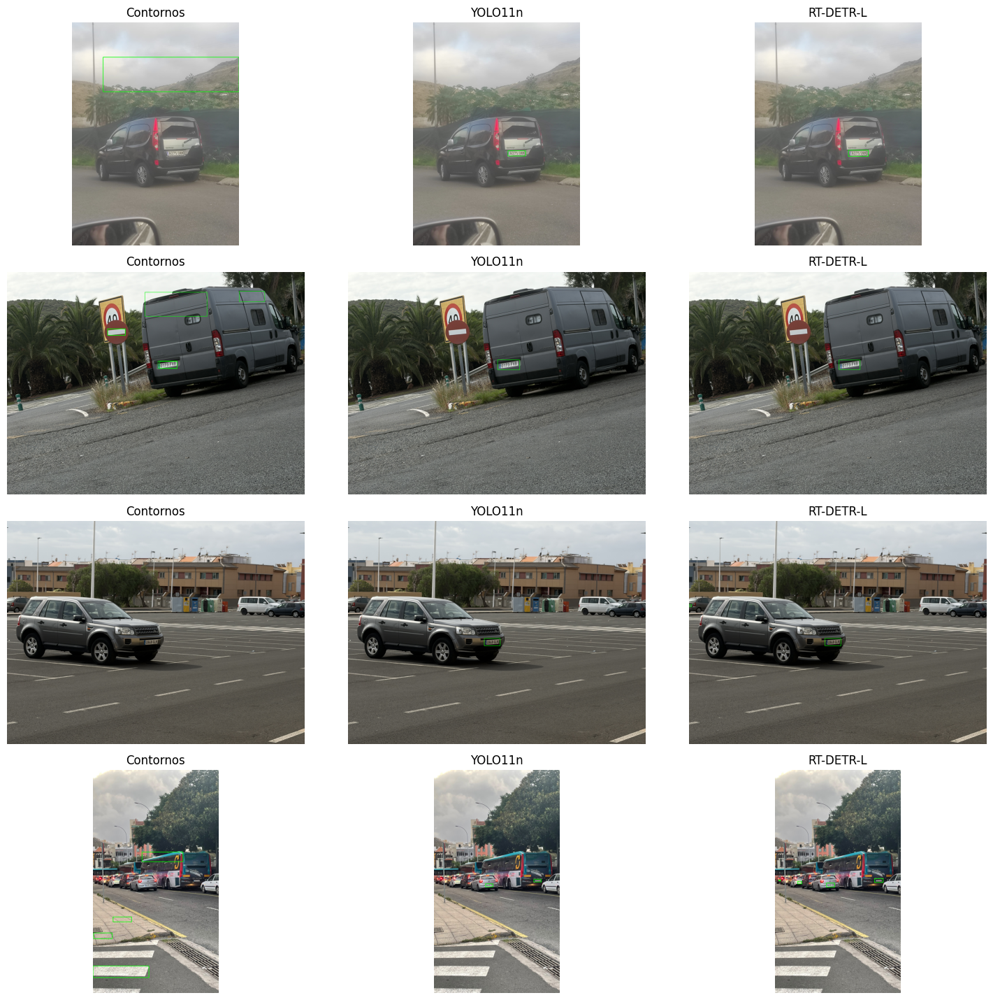

# Práctica 4 — Detección y seguimiento de personas, vehículos y matrículas

## 1. Objetivo

El objetivo de la práctica es desarrollar un sistema que detecte y siga personas y vehículos en un vídeo, localice las matrículas de los vehículos y trate de reconocer sus caracteres mediante OCR. Además, se comparan dos detectores de matrículas basados en aprendizaje profundo, YOLO11n y RT-DETR-L, con un método clásico de visión artificial basado en contornos.

La implementación está realizada en Python con Ultralytics, PyTorch, OpenCV, Pandas y EasyOCR. El cuaderno se ejecutó en un equipo con una GPU NVIDIA GeForce RTX 4060 Laptop GPU de 8 GB, Python 3.9.5, PyTorch 2.8.0+cu126 y Ultralytics 8.4.209.

## 2. Datos y preparación del conjunto de entrenamiento

### 2.1. Imágenes y anotaciones

El cuaderno encuentra **2.387 imágenes** en el directorio de fotografías y **2.418 archivos** en el directorio de anotaciones. Las anotaciones utilizadas en la ejecución corresponden a ficheros JSON con una estructura propia: cada objeto contiene un campo `rectangle` con la posición y dimensiones de la matrícula, y puede incluir el texto de la matrícula en el campo `plate`.

El procesamiento de estos JSON genera cajas delimitadoras normalizadas en el formato YOLO. Se utiliza una única clase, `plate`. Las imágenes con JSON asociado pero sin objetos anotados también se conservan como ejemplos negativos. Se contabilizan **5.236 matrículas anotadas** y **31 ficheros JSON sin una imagen asociada**, que se omiten.

Aunque el cuaderno contiene código auxiliar para otros formatos de anotación, la salida de la ejecución muestra que los ficheros presentes son JSON y que la conversión efectiva se realiza mediante el procesamiento específico del campo `rectangle`.

### 2.2. División del conjunto

El reparto se realiza de forma aleatoria con `random.seed(42)`. El código reserva primero el 20 % de las imágenes para test y, del resto, el 10 % para validación. Por ello, el porcentaje de validación se calcula sobre el conjunto restante y no sobre el total original.

| Partición | Imágenes |
|---|---:|
| Entrenamiento (`train`) | 1.719 |
| Validación (`val`) | 191 |
| Test (`test`) | 477 |
| **Total** | **2.387** |

El conjunto se organiza en directorios `train`, `val` y `test`, cada uno con subdirectorios `images` y `labels`. El archivo `plates.yaml` define las rutas, una única clase y el nombre `plate`.

**Acceso al conjunto de datos:** [[Enlace al dataset]](https://drive.google.com/drive/folders/1RFd6sKH_QMQcpE_w5rWmy8rKiYUY5_SI?usp=sharing).  

## 3. Entrenamiento de los detectores

Se entrenan dos detectores de matrículas con imágenes de tamaño **640 × 640**. El entrenamiento de RT-DETR-L se realiza durante 50 épocas, con batch de 8. Para YOLO11n, el código carga un checkpoint `last.pt` de una ejecución anterior y ejecuta otras 50 épocas con batch de 16.

**Importante sobre YOLO11n:** el entrenamiento adicional se guarda con el nombre `yolo11n_plates_ext`, pero las celdas posteriores de comparación cargan los pesos y leen el `results.csv` de `yolo11n_plates`, sin el sufijo `_ext`. Por tanto, las métricas de test y las curvas que aparecen en la comparativa corresponden a `yolo11n_plates`, no al entrenamiento adicional `yolo11n_plates_ext`. No deben atribuirse automáticamente los resultados de la comparativa a ese ajuste adicional.

### 3.1. YOLO11n

El entrenamiento adicional indicado en el cuaderno parte de:

```python
YOLO(f'{RUNS}/yolo11n_plates/weights/last.pt')
```

y ejecuta 50 épocas, con tamaño de imagen 640, batch 16, `patience=15` y `warmup_epochs=0`. La salida conservada no permite documentar aquí de forma completa la evolución ni el resultado final de esa ejecución adicional.

Para la evaluación de test, el cuaderno carga `runs/yolo11n_plates/weights/best.pt`. Los resultados de esa evaluación se recogen en la sección 4.

El modelo evaluado tiene **2.597.051 parámetros** y **6,4 GFLOPs**.

### 3.2. RT-DETR-L

RT-DETR-L se inicializa a partir de `rtdetr-l.pt` y se entrena durante 50 épocas, con imágenes de 640 × 640 y batch de 8. La ejecución termina correctamente en aproximadamente **1,447 horas**.

En la época 50 se registran las siguientes pérdidas:

- `giou_loss`: **0,5092**.
- `cls_loss`: **0,3744**.
- `l1_loss`: **0,09179**.

La validación final del mejor checkpoint obtiene:

- Precisión: **0,910**.
- Recall: **0,753**.
- mAP@0.5: **0,765**.
- mAP@0.5:0.95: **0,450**.
- Tiempo de inferencia: **12,1 ms por imagen**.

El modelo tiene **31.985.795 parámetros** y **105,3 GFLOPs**.

### 3.3. Evolución de pérdidas y métricas

El cuaderno genera tres gráficas a partir de los ficheros `results.csv`:

1. Pérdida de cajas durante el entrenamiento.
2. Pérdida de cajas durante la validación.
3. mAP@0.5 de validación a lo largo de las épocas.

Para RT-DETR-L se utiliza `giou_loss` cuando no está disponible `box_loss`. Estas curvas permiten observar la evolución del aprendizaje y las oscilaciones entre épocas.

La celda de gráficas lee las ejecuciones `yolo11n_plates` y `rtdetr_l_plates`. En consecuencia, la curva de YOLO corresponde a la ejecución base y no a `yolo11n_plates_ext`. Para que la memoria pueda mostrar y contrastar la evolución completa, deben adjuntarse los `results.csv` y las gráficas generadas por el cuaderno.

**Gráficas del entrenamiento:** . 

## 4. Comparación de YOLO11n y RT-DETR-L en test

La función `eval_model` evalúa los mejores pesos sobre la partición `test`, con tamaño de imagen 640 y el dispositivo configurado en el cuaderno. Los resultados registrados son:

| Modelo | Precisión | Recall | mAP@0.5 | mAP@0.5:0.95 | Inferencia (ms/imagen) |
|---|---:|---:|---:|---:|---:|
| YOLO11n | 0,9003 | 0,6048 | 0,6228 | 0,3405 | 3,4196 |
| RT-DETR-L | 0,8594 | 0,7029 | 0,6970 | 0,3955 | 21,6959 |

RT-DETR-L obtiene un recall, un mAP@0.5 y un mAP@0.5:0.95 superiores. Por tanto, en este conjunto de test localiza una mayor proporción de matrículas y consigue mejores resultados globales según las métricas mAP. YOLO11n alcanza una precisión mayor y un tiempo de inferencia considerablemente menor.

La elección depende del objetivo: YOLO11n resulta más conveniente cuando la velocidad es prioritaria, mientras que RT-DETR-L ofrece mayor exhaustividad de detección a costa de un tiempo de inferencia superior.

Estos resultados deben interpretarse teniendo en cuenta la diferencia de ejecuciones descrita en la sección 3.1: la evaluación de YOLO carga `yolo11n_plates`, aunque el cuaderno también lanza un entrenamiento adicional guardado como `yolo11n_plates_ext`.

## 5. Comparación con un método clásico basado en contornos

Como alternativa a los detectores entrenados, se implementa un método clásico con OpenCV. El procedimiento es:

1. Convertir la imagen a escala de grises.
2. Aplicar un filtro bilateral para reducir el ruido y conservar los bordes.
3. Detectar bordes mediante Canny y aplicar dilatación.
4. Extraer contornos y aproximarlos mediante polígonos.
5. Conservar candidatos de cuatro vértices, área mínima y relación de aspecto entre 2,0 y 6,5.

El rango de relación de aspecto se elige teniendo en cuenta la forma rectangular de las matrículas. El método no aprende a partir de ejemplos y depende principalmente de características geométricas, por lo que puede confundir matrículas con otros elementos rectangulares de la escena.

La evaluación se realiza sobre las imágenes de test. Una predicción se considera correcta cuando su IoU con una caja real es igual o superior a 0,5. Los resultados son:

| Método | Precisión | Recall | F1 | TP | FP | FN |
|---|---:|---:|---:|---:|---:|---:|
| Contornos (OpenCV) | 0,124 | 0,096 | 0,108 | 101 | 716 | 949 |
| YOLO11n | 0,874 | 0,623 | 0,727 | 654 | 94 | 396 |
| RT-DETR-L | 0,781 | 0,722 | 0,750 | 758 | 213 | 292 |

El método de contornos obtiene resultados claramente inferiores y genera numerosos falsos positivos. La forma rectangular por sí sola no basta para distinguir una matrícula de otros elementos de la imagen.

Entre los detectores entrenados, RT-DETR-L consigue el mayor recall y el mejor F1, mientras que YOLO11n obtiene mayor precisión. Esto refleja el compromiso entre detectar más matrículas y reducir las detecciones incorrectas.

El cuaderno también genera una comparación visual sobre cuatro imágenes de test, mostrando las detecciones de contornos, YOLO11n y RT-DETR-L.

**Ejemplos visuales:** .  
No se registra una medición de tiempo comparable para el método de contornos, por lo que no se incluye una cifra de velocidad.

## 6. Procesamiento del vídeo: seguimiento, matrículas y OCR

El pipeline completo procesa el vídeo de test `C0142.mp4`. En la ejecución con salida conservada se utiliza RT-DETR-L como detector de matrículas. La detección de personas y vehículos se realiza con YOLO11 y el seguimiento con ByteTrack.

### 6.1. Detección y seguimiento

Se detectan las siguientes clases COCO:

| Clase | Identificador COCO |
|---|---:|
| Persona (`person`) | 0 |
| Coche (`car`) | 2 |
| Motocicleta (`motorcycle`) | 3 |
| Autobús (`bus`) | 5 |
| Camión (`truck`) | 7 |

ByteTrack asigna identificadores a los objetos para mantener su identidad entre fotogramas. Para cada vehículo se recorta la región correspondiente y se ejecuta el detector de matrículas seleccionado.

El pipeline diferencia entre un conteo bruto de identificadores únicos y un conteo filtrado. El filtro exige una permanencia mínima de 15 fotogramas. Además, para coches, autobuses y camiones se aplica un umbral mínimo al área máxima de la caja con respecto al área del fotograma, con el objetivo de reducir el recuento de vehículos pequeños o aparcados que reaparecen con identificadores distintos.

### 6.2. Reconocimiento de matrículas (OCR)

El cuaderno intenta utilizar EasyOCR. La preparación de cada recorte incluye conversión a escala de grises, ampliación mediante interpolación cúbica y, en la configuración base, aplicación de CLAHE para mejorar el contraste. El reconocimiento limita los caracteres permitidos a letras mayúsculas y números.

Después se normaliza el texto mediante reglas que contemplan confusiones habituales entre caracteres, como `O` y `0`, `I` y `1`, `S` y `5`, entre otras. También se comprueba que el resultado encaje con plantillas de matrículas contempladas en el código.

Las lecturas se acumulan por identificador de seguimiento y se tienen en cuenta sus confianzas, de forma que el texto asociado al vehículo no dependa de una única lectura.

La instalación de EasyOCR mediante `%pip` no se completó: Windows devolvió `WinError 5` al intentar acceder a `cv2.pyd`. Sin embargo, la salida de la ejecución del pipeline muestra que el lector OCR sí estaba disponible en el entorno utilizado para esa ejecución.

### 6.3. Pruebas y ajuste del OCR

Además de utilizar OCR en el vídeo, el cuaderno realiza pruebas sobre recortes de matrículas del conjunto de test.

Primero compara cinco variantes de preprocesamiento y lectura sobre **150 recortes**. La configuración `detect + CLAHE` obtiene un **43,3 % de acierto exacto** y un **62,0 % de resultados con formato válido**. Las otras variantes evaluadas obtienen porcentajes de acierto exacto inferiores.

Posteriormente se realiza una búsqueda por coordenadas de parámetros, utilizando 100 recortes para el ajuste y 50 para validación. La configuración seleccionada modifica tres parámetros respecto a la configuración base:

- `clahe=False`.
- `text_threshold=0.85`.
- `width_ths=0.7`.

En los 100 recortes de ajuste, el acierto exacto pasa de **0,48** con la configuración base a **0,54** con la configuración ajustada. En los 50 recortes reservados para validación, ambas configuraciones obtienen **0,54** de acierto exacto. Por tanto, el ajuste mejora el resultado medido en el conjunto de ajuste, pero no muestra una mejora en el conjunto reservado.

También se analiza la influencia del ancho de la matrícula en la imagen. En una muestra de hasta 300 recortes, los resultados muestran que las matrículas de mayor anchura se reconocen mejor: para el tramo de más de 90 píxeles se obtiene un 0,433 de acierto exacto, mientras que para anchuras entre 45 y 60 píxeles el acierto exacto es 0,115. Esto evidencia la importancia de la resolución del recorte.

### 6.4. Resultados del vídeo

La ejecución de RT-DETR-L procesa **2.832 fotogramas** y tarda aproximadamente **635 segundos**. La salida del pipeline registra el siguiente conteo bruto de identificadores únicos:

| Clase | Identificadores únicos |
|---|---:|
| Coches | 220 |
| Autobuses | 4 |
| Personas | 40 |
| Camiones | 11 |
| Motocicletas | 3 |

Tras aplicar el filtro de permanencia mínima de 15 fotogramas y el filtro de área a coches, autobuses y camiones, la salida muestra:

| Clase | Objetos contabilizados tras el filtro |
|---|---:|
| Coches | 28 |
| Autobuses | 1 |
| Personas | 20 |
| Motocicletas | 3 |
| Camiones | No aparece ningún objeto en el conteo filtrado |

La salida del propio pipeline informa de **49 vehículos con matrícula detectada** y de **3 vehículos con texto OCR válido**, asociados en esa salida a los identificadores `555`, `626` y `660`.

Hay una discrepancia entre esa cifra y la inspección posterior del CSV: la celda que agrupa el CSV por identificador informa de **35 vehículos con matrícula detectada**, también con **3 textos no vacíos**. Además, los ejemplos de texto que aparecen en esa inspección incluyen los identificadores `626` y `341`. Por tanto, las salidas guardadas en el cuaderno no permiten reconciliar completamente los identificadores y el número de matrículas detectadas entre el resumen del pipeline y el CSV. Para la entrega debe tomarse como referencia el vídeo y el CSV finales de una misma ejecución, y volver a generar ambos si se necesita una cifra única y consistente.

### 6.5. Vídeo de salida

El pipeline genera un vídeo anotado (`resultado_rtdetr.mp4`, según la configuración del pipeline) con las cajas de detección, identificadores de seguimiento, cajas de matrícula y texto OCR cuando está disponible. También muestra un resumen de los objetos contabilizados.

**Vídeo de test procesado:** Se encuentra en resultados/resultado_rtdetr.mp4 en este mismo repositorio.

## 7. Volcado CSV

El procesamiento genera un CSV con una fila por objeto detectado en cada fotograma. La inspección del fichero registrada en el cuaderno muestra una dimensión de **20.941 filas y 15 columnas**.

| Columna | Descripción |
|---|---|
| `fotograma` | Número del fotograma procesado. |
| `tipo_objeto` | Clase del objeto detectado. |
| `confianza` | Confianza de la detección del objeto. |
| `identificador_tracking` | Identificador asignado por ByteTrack. |
| `x1`, `y1`, `x2`, `y2` | Coordenadas de la caja del objeto. |
| `matricula_en_su_caso` | Indica si se ha localizado una matrícula para el objeto. |
| `confianza_matricula` | Confianza de la detección de matrícula. |
| `mx1`, `my1`, `mx2`, `my2` | Coordenadas de la caja de matrícula. |
| `texto_matricula` | Texto reconocido para la matrícula, cuando está disponible. |

El recuento de filas por clase que aparece al inspeccionar el CSV es:

| Clase | Filas |
|---|---:|
| Coche (`car`) | 17.431 |
| Persona (`person`) | 3.161 |
| Autobús (`bus`) | 212 |
| Motocicleta (`motorcycle`) | 89 |
| Camión (`truck`) | 48 |
| **Total** | **20.941** |

El texto OCR puede estar vacío cuando no se consigue una lectura válida. El CSV debe incluirse como fichero real en la entrega, no únicamente mediante una captura.

**CSV de salida:** Se encuentra en resultados/resultado.csv en este mismo repositorio.

## 8. Conclusiones

La práctica compara dos detectores de matrículas basados en aprendizaje profundo con un método clásico de contornos. El método de contornos obtiene una precisión, un recall y un F1 muy bajos, y genera numerosos falsos positivos. Los resultados muestran que los criterios geométricos por sí solos no son suficientes para localizar matrículas de forma robusta en las imágenes utilizadas.

En la evaluación sobre test, RT-DETR-L consigue mayor recall y mAP que YOLO11n, mientras que YOLO11n ofrece mayor precisión y un tiempo de inferencia mucho menor. La elección depende, por tanto, de si se prioriza la velocidad o la detección de una mayor proporción de matrículas.

El pipeline de vídeo combina detección de objetos, seguimiento mediante ByteTrack, detección de matrículas y OCR. El seguimiento permite mantener identificadores entre fotogramas y aplicar filtros para el conteo. El reconocimiento de texto es la parte más sensible a la calidad de imagen: las pruebas con recortes muestran que una mayor anchura de matrícula favorece la lectura.

En la ejecución registrada se procesaron 2.832 fotogramas. No obstante, existe una discrepancia entre el resumen del pipeline y la inspección posterior del CSV en el número de vehículos con matrícula detectada y en algunos identificadores con texto. Es importante generar y entregar el vídeo y el CSV de una misma ejecución para que los resultados finales sean coherentes.

